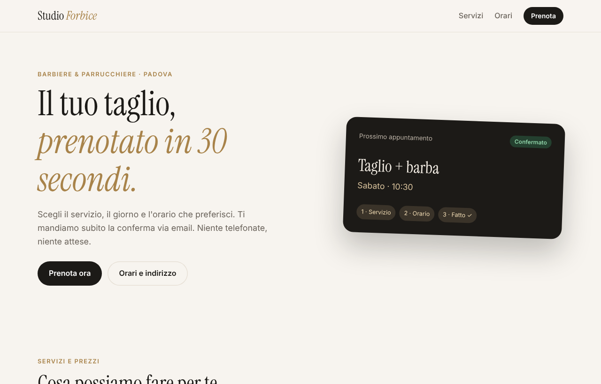
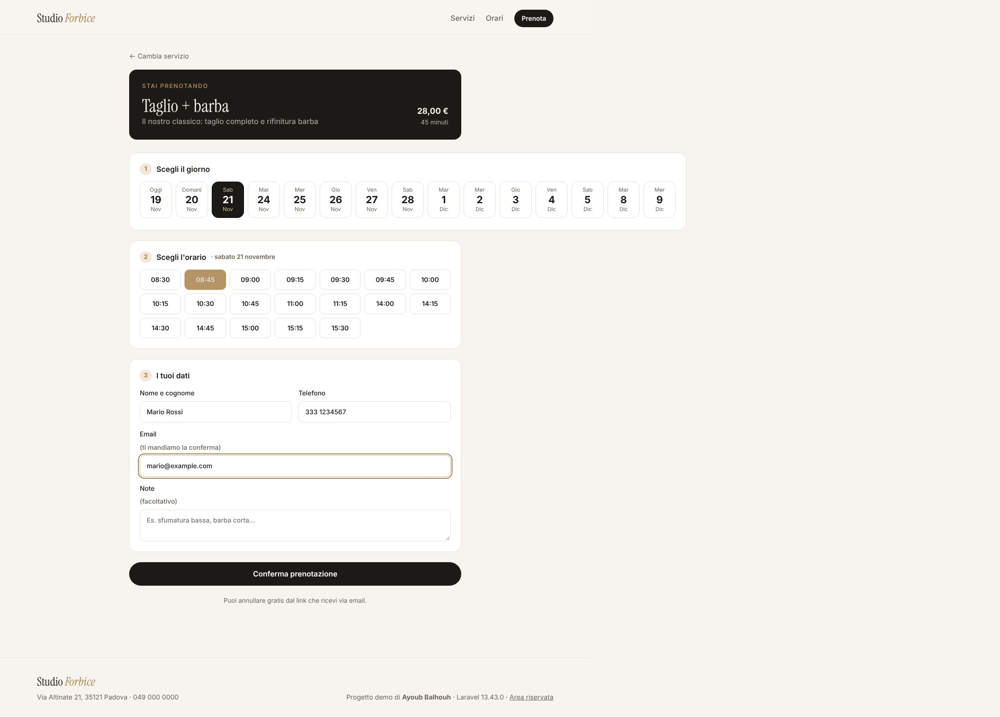
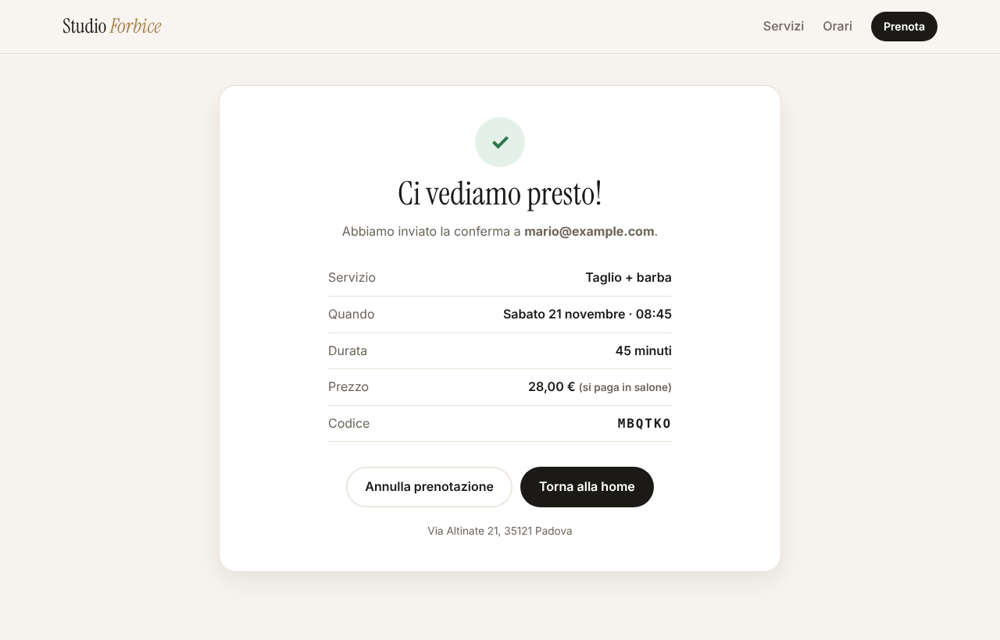
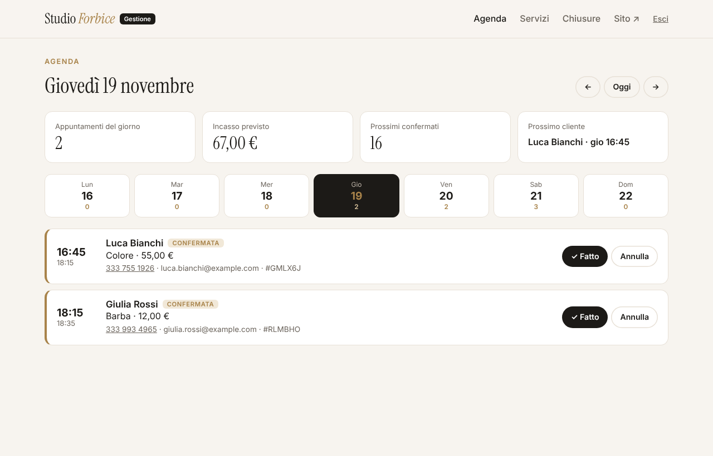
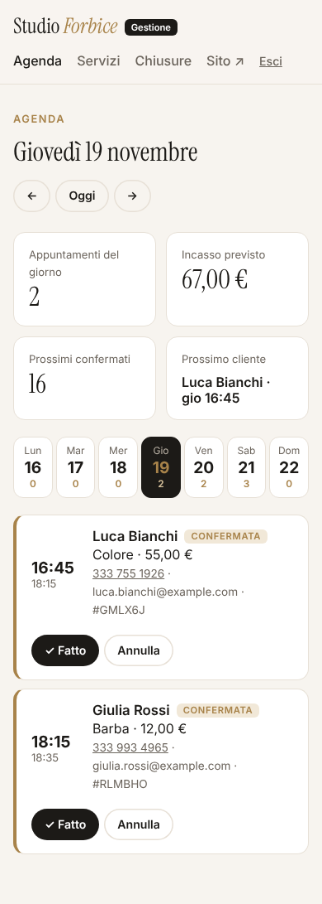

# Studio Forbice · Prenotazioni online

Sistema di prenotazione per un barbiere/parrucchiere, realizzato con **Laravel** da **Ayoub Balhouh**.

Il cliente sceglie servizio, giorno e orario e riceve la conferma via email.
Il titolare gestisce agenda, servizi e giorni di chiusura da un'area riservata.



## Funzionalità

**Sito pubblico**
- Elenco servizi con durata e prezzo
- Calendario dei prossimi 21 giorni e orari liberi aggiornati senza ricaricare la pagina
- Orari calcolati da apertura, pausa pranzo, chiusure, preavviso minimo e appuntamenti già presi
- Nessuna doppia prenotazione: controllo dentro una transazione
- Email di conferma con link per vedere o annullare l'appuntamento

**Area riservata** (`/admin`)
- Agenda giornaliera con vista settimanale, incasso previsto e prossimo cliente
- Segna gli appuntamenti come completati o annullati
- Gestione dei servizi (CRUD); un servizio con prenotazioni viene disattivato, non cancellato
- Giorni di chiusura (ferie, festivi) con avviso se ci sono prenotazioni da spostare

**Qualità**
- Test automatici (PHPUnit) su orari, doppie prenotazioni, annullamento, login e CRUD
- GitHub Actions esegue i test a ogni push
- Login con limite di tentativi, CSRF, validazione lato server
- Layout responsive, interfaccia in italiano

| Prenotazione | Conferma |
|---|---|
|  |  |

| Agenda | Agenda da mobile |
|---|---|
|  |  |

## Tecnologie
PHP 8.3, Laravel 13, Eloquent, Blade, SQLite (o MySQL), JavaScript vanilla, CSS senza framework.

## Struttura principale
- `app/Services/SlotFinder.php` – calcolo degli orari disponibili
- `app/Http/Controllers/BookingController.php` – prenotazione lato cliente
- `app/Http/Controllers/Admin/` – agenda, servizi, chiusure, login
- `config/salone.php` – orari di apertura, pausa pranzo, preavviso
- `tests/Feature/BookingTest.php` – test

## Avvio in locale

```bash
git clone https://github.com/ayoubbalhouh/salone-prenotazioni.git
cd salone-prenotazioni
composer install
cp .env.example .env
php artisan key:generate
touch database/database.sqlite
php artisan migrate --seed
php artisan serve
```

Apri http://127.0.0.1:8000. Area riservata: `/admin/login` con **admin@studioforbice.test** / **password**.

Le email in locale vengono scritte in `storage/logs/laravel.log` (`MAIL_MAILER=log`).

Test:

```bash
php artisan test
```
